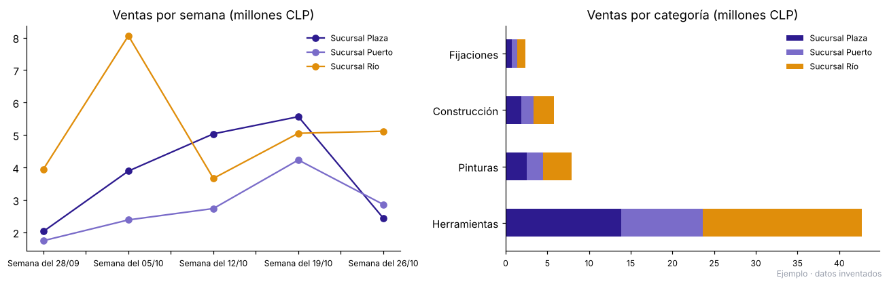

# Automatización de informes de ventas en Excel

  

> **Demostración con datos inventados.** La ferretería, sus sucursales y sus ventas son ficticias y se generan con `generar_planillas.py`. Ningún dato corresponde a una empresa real.

## El problema

Una ferretería con tres sucursales arma su informe mensual a mano. Cada sucursal manda su planilla con un formato distinto:

| Sucursal | Archivo | Qué trae mal |
| --- | --- | --- |
| Río | Excel | Boletas repetidas al copiar y pegar |
| Plaza | Excel | Fechas como texto (dd/mm/aaaa), montos como "$6.490", boletas repetidas |
| Puerto | CSV con punto y coma | Productos en mayúsculas y con espacios, una fila de "TOTAL" escrita a mano |

Juntar todo, limpiarlo y hacer las tablas toma horas cada mes, y cualquier error de copiar y pegar cambia las cifras.

## La solución

Un script en Python que, con un solo comando, lee las tres planillas, las limpia, revisa la calidad de los datos y genera el informe en Excel, con formato y gráficos, listo para enviar.

```bash
python consolidar.py
```

## Qué entrega

`salida/informe_ventas_2026-10.xlsx`, con seis hojas:

| Hoja | Contenido |
| --- | --- |
| Resumen | Ventas, unidades, boletas, ticket promedio y participación por sucursal, con gráfico |
| Por semana | Ventas semanales por sucursal, con gráfico |
| Por categoría | Ventas por categoría y sucursal |
| Top 10 productos | Los productos que más venden |
| Revisión de datos | Cuántas filas llegaron, cuántas se descartaron y por qué |
| Datos limpios | Todas las ventas unidas en un solo formato, para revisar o seguir analizando |



La hoja **Revisión de datos** deja constancia de cada corrección, para que nadie tenga que confiar a ciegas en el resultado:

| Revisión | Plaza | Puerto | Río |
| --- | --- | --- | --- |
| Filas recibidas | 349 | 282 | 455 |
| Filas de total escritas a mano | 0 | 1 | 0 |
| Filas con datos ilegibles | 0 | 0 | 0 |
| Boletas repetidas | 5 | 0 | 12 |
| Filas válidas en el informe | 344 | 281 | 443 |

## Cómo se adapta a otra empresa

Cada formato se describe una sola vez al inicio de `consolidar.py` (nombre del archivo, nombre de cada columna y formato de fecha). Si llega una sucursal nueva o cambia una planilla, se agrega o se corrige una línea, sin tocar el resto.

El mismo esquema sirve para informes de asistencia, inventario, cobranza o notas, y se puede programar para que corra solo cada semana o cada mes.

## Cómo ejecutarlo

```bash
pip install -r requirements.txt
python generar_planillas.py   # crea las planillas de ejemplo en entrada/
python consolidar.py          # genera el informe en salida/
```

---

¿Tu equipo pierde horas armando informes a mano? [Sivax Intelligence](https://sivax-intelligent.netlify.app/) · [sivax.contacto@gmail.com](mailto:sivax.contacto@gmail.com)
